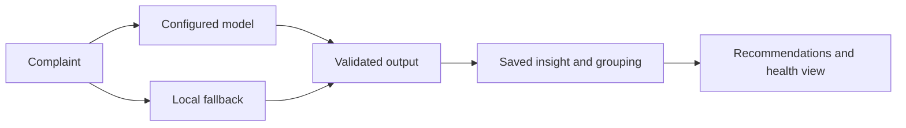

# ProductPulse — Customer Complaints to Product Intelligence

ProductPulse helps ecommerce teams turn customer complaints into structured issue records, related complaint groups, recommendations, and a product-health view.

**Stack:** FastAPI, Python, MongoDB, React, Tailwind, and the official Anthropic SDK.

## Analysis flow



## Engineering highlights

- One analysis schema supports both model-assisted analysis and a deterministic local fallback.
- Analysis, saved insights, recommendations, and alerts form an inspectable application workflow.
- The local engine supports evaluation without a paid model key.
- Domain tests cover classification, validation, clustering, health, and impact calculations.

## Review the implementation

| Question | Start here |
| --- | --- |
| How are model and local outputs represented? | [Analysis engine](backend/ai_engine.py) |
| Which domain behaviors are tested offline? | [Engine tests](tests/test_engine.py), [proof-of-concept checks](tests/poc_core.py) |
| How does the API persist and expose results? | [API](backend/server.py), [API integration checks](backend/backend_test.py) |
| How is synthetic demonstration data prepared? | [Demo seed](backend/seed.py) |
| How is the UI organized? | [Frontend source](frontend/src/) |

For a short demonstration, analyze two related synthetic complaints, inspect the reported engine, save the insights, and trace the resulting recommendation and product-health change.

## Run locally

With Docker, Python, and the frontend prerequisites configured:

```sh
./dev.sh
```

The operating guide documents manual setup, environment variables, and the seeded demo account. Use a local isolated environment; review demo/reset behavior before deploying beyond it.

## Verification

After installing backend dependencies in a virtual environment:

```sh
backend/.venv/bin/python -m pytest tests/
backend/.venv/bin/python tests/poc_core.py
```

API integration checks require a running backend. These are available commands, not a claim of a fresh passing run.

## Scope

Root-cause suggestions and confidence values require human review. Product-health scores and impact estimates use documented heuristics; they are not measured causal effects or validated forecasts. Output identifies whether analysis came from the model, the local engine, or fallback.

[Detailed setup and operating guide](https://github.com/martinlepage26-bit/productpulse/blob/821c1d01a6603d0febebcec0b27a44f9c1095572/README.md)
